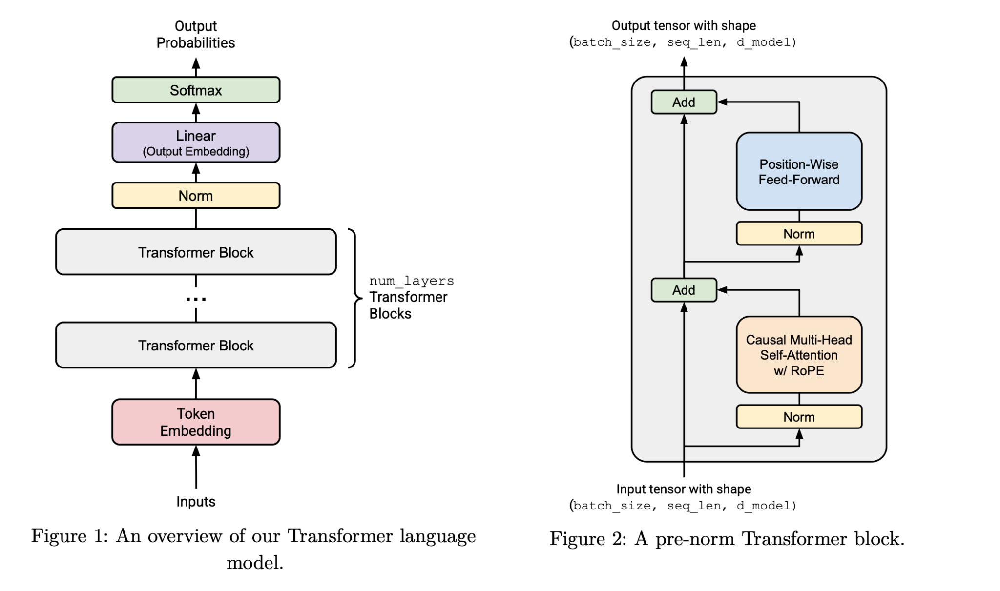
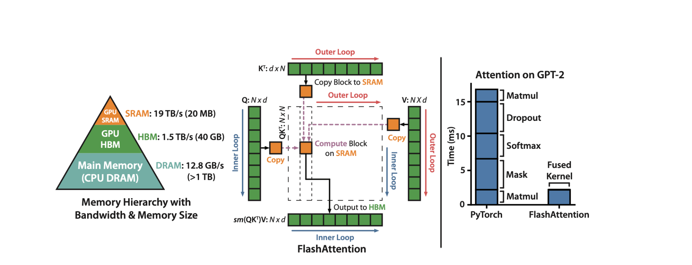
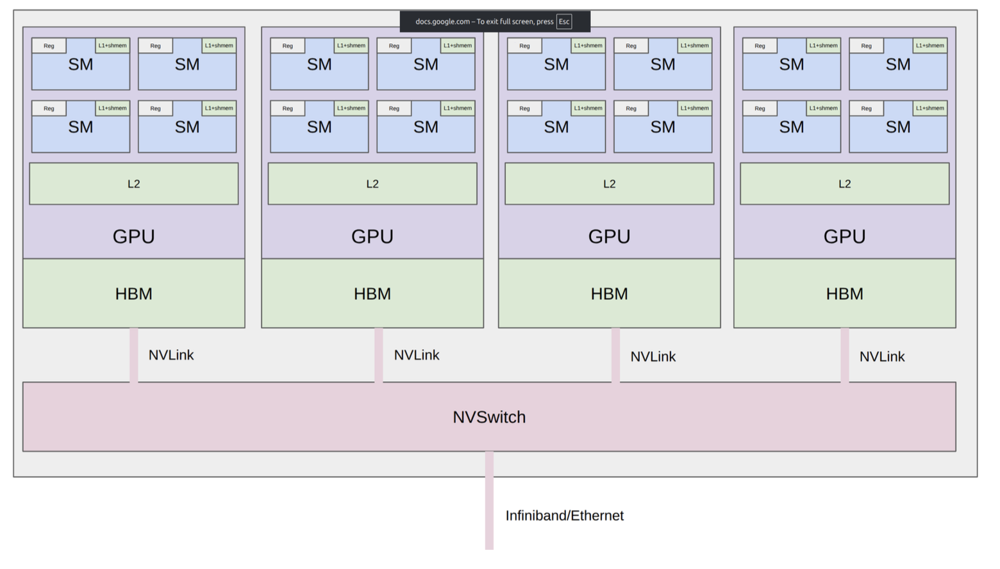

# LLM Systems: Building Language Models from Scratch

An independent project building language models end-to-end tokenization, Transformer architecture, training, and the systems engineering underneath them (custom kernels, distributed training). Core ideas draw on [Stanford's CS336](https://cs336.stanford.edu/) as a reference framework, extended and benchmarked as ongoing work.

> **Status:** Transformer + training pipeline complete · OpenWebText training in progress (~37%) · FlashAttention2 (PyTorch + Triton) implemented & benchmarked · DDP + FSDP implemented (benchmarking next)

<!-- Optional: add LinkedIn post link after publishing
**LinkedIn:** [post title](https://www.linkedin.com/in/parshwa-patel-aa46683a2?utm_source=share_via&utm_content=profile&utm_medium=member_android)
-->

---

## What's in this repo

| Folder | Focus | Status |
|--------|--------|--------|
| [`assignment1_basics/`](./assignment1_basics/) | BPE tokenizer, modern Transformer LM, AdamW training loop, decoding | Core done · OWT ~37% |
| [`assignment2_systems/`](./assignment2_systems/) | Profiling, mixed precision, **FlashAttention2** (PyTorch + Triton), **DDP + FSDP**, benches | FlashAttn benchmarked · DDP/FSDP implemented |
| [`common/`](./common/) | Shared model/data code | — |
| [`docs/results.md`](./docs/results.md) | Loss curves, benchmark numbers | Updated |

Course-provided scaffolding/tests retain Stanford's MIT license; all implementation code is my own work.

---

## Architecture

Decoder-only Transformer LM, aligned with current open-model defaults:

| Component | Choice |
|-----------|--------|
| Block layout | Pre-norm residual stream |
| Normalization | RMSNorm |
| Position | RoPE on Q/K |
| FFN | SwiGLU |
| Attention | Causal multi-head self-attention (+ FlashAttention2) |
| Optimizer | AdamW + decoupled weight decay |
| LR schedule | Linear warmup → cosine decay |
| Tokenizer | Byte-level BPE (GPT-2-style pretokenization) |

### Transformer architecture



*High-level model architecture and pre-norm Transformer block.*

**Key references:** Vaswani et al. 2017 (Transformer) · Sennrich et al. 2016 (BPE) · Xiong et al. 2020 (Pre-LN placement) · Su et al. 2021 (RoPE) · Shazeer 2020 (SwiGLU) · Zhang & Sennrich 2019 (RMSNorm) · Loshchilov & Hutter 2017 (AdamW) · Dao et al. 2022/2023 (FlashAttention / FlashAttention-2) · Rajbhandari et al. 2020 (ZeRO, for FSDP)

```
tokens [B, S]
  → Embedding [B, S, D]
  → N × (RMSNorm → Causal MHA+RoPE(+FlashAttn2) → + → RMSNorm → SwiGLU → +)
  → Final RMSNorm
  → LM head → logits [B, S, V]
```

---

## Results

### Training — OpenWebText

| Run | Dataset | Notes | Val loss / PPL | Status |
|-----|---------|-------|----------------|--------|
| Baseline | TinyStories | Transformer LM + BPE | _add number_ | Done |
| OWT | OpenWebText | 4 resumed runs (checkpointed across sessions) | val_loss 3.349 @ 37.1% steps (37.1k/100k) | In progress |


*Validation-loss curves from the training runs currently tracked in the project.*

### FlashAttention2 forward (T4 GPU, causal)

Custom PyTorch tiled implementation vs. a fused **Triton** kernel of the same algorithm. Headline at `seq_len=1024`, **fp16**, `d=128`:

| Impl | Time | Speedup |
|------|------|---------|
| Triton (fused kernel) | **2.52 ms** | **~487×** |
| PyTorch (tiled, looped) | 1226.90 ms | 1× |

Scaling (fp16, `d=128`):

| seq_len | PyTorch | Triton | Speedup |
|---------|---------|--------|---------|
| 128 | 27.71 ms | 0.20 ms | ~139× |
| 512 | 327.67 ms | 0.72 ms | ~455× |
| 1024 | 1226.90 ms | 2.52 ms | ~487× |



*FlashAttention's tiled computation and the memory hierarchy that motivates it.*

Code: [`FA2_pytorch.py`](./assignment2_systems/cs336_systems/FA2_pytorch.py) · [`FA2_triton.py`](./assignment2_systems/cs336_systems/FA2_triton.py) · [`flash_benchmarking.py`](./assignment2_systems/cs336_systems/flash_benchmarking.py)

### Distributed training — DDP + FSDP

Multi-GPU training splits work in fundamentally different ways depending on the strategy, and both are implemented here from scratch (no `torch.nn.parallel.DistributedDataParallel`, no `FSDP` wrapper):

**Distributed Data Parallel (DDP)**
- Each process holds a full replica of the model
- Gradients are synchronized across processes after the backward pass so every replica applies the same update



*Example multi-GPU system topology illustrating the hardware/communication environment distributed training targets.*

**Fully Sharded Data Parallel (FSDP) — simplified**
- Parameters are sharded across processes instead of replicated — each process only holds a slice of the full model
- Full parameters are reconstructed on demand via **all-gather** immediately before they're needed for compute, then released
- Gradients are synchronized back into sharded form via **reduce-scatter**, so each process only keeps the gradient slice it owns
- Requires a **custom `autograd.Function`** — standard autograd assumes a process owns the full parameter tensor it's differentiating through, which breaks under sharding. Getting the backward pass to correctly route gradients back to the right shard, rather than silently computing against reconstructed-but-detached tensors, was the hardest part of this implementation.

**Correctness:** verified that training with the sharded/distributed implementations produces output matching a non-sharded, single-process baseline — confirming the custom autograd and communication logic are numerically correct, not just runnable.

The interesting trade-off FSDP makes explicit: DDP is communication-light but memory-heavy (full model × N processes), while FSDP trades additional communication (all-gather every forward/backward) for a much smaller per-process memory footprint — the same idea behind how large models are trained across GPUs that couldn't otherwise hold them.

Multi-GPU scaling and communication-overhead benchmarks not yet run — planned next.

Full tables: [`docs/results.md`](./docs/results.md)

---

## Repository layout

```text
llm-systems-from-scratch/
├── README.md
├── assignment1_basics/      # tokenizer, model, train, decode
├── assignment2_systems/     # profiling, FlashAttention2, DDP, FSDP
├── common/
└── docs/
    ├── results.md
    └── assets/
```

Large artifacts (`*.pt`, `*.bin`, datasets, `wandb/`) are **not** committed — see `.gitignore`.

---

## Quick start

```bash
# Core model + training
cd assignment1_basics
uv sync

# Systems: FlashAttention2, DDP, FSDP
cd ../assignment2_systems
uv sync
# FlashAttention bench (needs CUDA):
# PYTHONPATH=. python cs336_systems/flash_benchmarking.py
```

---

## Progress log

| When | Update |
|------|--------|
| — | Transformer LM + BPE tokenizer + training/decoding (core complete) |
| — | OpenWebText training in progress (37.1k/100k, val_loss 3.349) |
| — | FlashAttention2 (PyTorch + Triton) implemented & benchmarked — up to ~487× fwd speedup @ 1024/fp16/d=128 |
| — | DDP + FSDP implemented (parameter sharding, all-gather, reduce-scatter, custom autograd) |
| _next_ | Multi-GPU DDP/FSDP benchmarks · finish OWT run · continue systems work |

---

## Notes

This is an independent, ongoing project — built and extended on my own, using CS336's problem framing as a starting reference rather than a fixed syllabus. If you're a current CS336 student, do your own work — the value is in implementing these pieces yourself.
