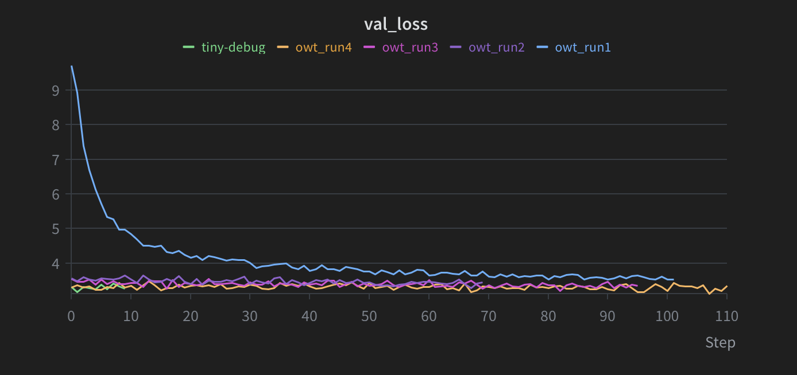

# LLM Systems: Building Language Models from Scratch

A from-scratch implementation of the full language-model stack: byte-level BPE tokenization, a modern decoder-only Transformer, a training pipeline, and the systems layer underneath it, including FlashAttention-2 (PyTorch and Triton), and Data Parallel and Fully Sharded Data Parallel training written without the built-in PyTorch wrappers.

Built following the problem framing of [Stanford CS336](https://cs336.stanford.edu/) though it does not reflect the structure of actual assignments.

## Highlights

- **Tokenizer to trained model, end to end:** byte-level BPE, a RoPE/SwiGLU/RMSNorm Transformer, an AdamW training loop, and decoding. Reached **1.49 validation loss on TinyStories**.
- **FlashAttention-2 in two forms:** a tiled PyTorch implementation (forward and backward via recomputation) and a fused Triton forward kernel with online softmax. The Triton kernel is up to **~487× faster** than the looped PyTorch version on a T4.
- **DDP and FSDP from scratch:** no `DistributedDataParallel`, no `FSDP` wrapper. Includes parameter sharding, all-gather, reduce-scatter, and a custom `autograd.Function`, verified numerically against a single-process baseline.

---

## Repository

| Folder | Contents |
|--------|----------|
| [`assignment1_basics/`](./assignment1_basics/) | BPE tokenizer, Transformer LM, AdamW and training loop, decoding |
| [`assignment2_systems/`](./assignment2_systems/) | Benchmarking and profiling, mixed precision, activation checkpointing, FlashAttention-2, DDP, optimizer state sharding, FSDP |
| [`common/`](./common/) | Shared model and data code |
| [`docs/results.md`](./docs/results.md) | Full loss curves and benchmark tables |

```text
llm-systems-from-scratch/
├── README.md
├── assignment1_basics/      # tokenizer, model, train, decode
├── assignment2_systems/     # profiling, FlashAttention-2, DDP, FSDP
├── common/
└── docs/
    ├── results.md
    └── assets/
```

---

## Model Architecture

A decoder-only Transformer using current open-model defaults:

| Component | Choice |
|-----------|--------|
| Block layout | Pre-norm residual stream |
| Normalization | RMSNorm |
| Position encoding | RoPE on Q/K |
| Feed-forward | SwiGLU |
| Attention | Causal multi-head self-attention (optionally FlashAttention-2) |
| Optimizer | AdamW with decoupled weight decay |
| LR schedule | Linear warmup, then cosine decay |
| Tokenizer | Byte-level BPE with GPT-2-style pretokenization |


```
tokens [B, S]
  → Embedding [B, S, D]
  → N × (RMSNorm → Causal MHA + RoPE (+ FlashAttn2) → + → RMSNorm → SwiGLU → +)
  → Final RMSNorm
  → LM head → logits [B, S, V]
```

**References:** Vaswani et al. 2017 (Transformer) · Sennrich et al. 2016 (BPE) · Xiong et al. 2020 (Pre-LN) · Su et al. 2021 (RoPE) · Shazeer 2020 (SwiGLU) · Zhang & Sennrich 2019 (RMSNorm) · Loshchilov & Hutter 2017 (AdamW) · Dao et al. 2022/2023 (FlashAttention, FlashAttention-2) · Rajbhandari et al. 2020 (ZeRO)

---

## Results

### Language model training

| Run | Dataset | Setup | Result |
|-----|---------|-------|--------|
| Baseline | TinyStories | Transformer LM with BPE tokenizer | Val loss **1.49** |
| Scale-up | OpenWebText | 4 checkpointed, resumed runs across sessions | Val loss **3.349** at 37.1k steps |



### FlashAttention-2 forward pass (T4 GPU, causal, fp16, `d=128`)

Two implementations of the same tiled algorithm: a PyTorch version that launches work per tile from Python, and a fused Triton kernel.

| seq_len | PyTorch (tiled, looped) | Triton (fused) | Speedup |
|---------|-------------------------|----------------|---------|
| 128 | 27.71 ms | 0.20 ms | ~139× |
| 512 | 327.67 ms | 0.72 ms | ~455× |
| 1024 | 1226.90 ms | 2.52 ms | ~487× |

The gap comes from execution-model overhead, not a different algorithm. The PyTorch version pays Python-to-CUDA launch cost on every tile, while the Triton kernel fuses the whole loop into a single launch and keeps tiles in on-chip memory.

The PyTorch implementation covers forward and backward (via recomputation, with `torch.compile`). The Triton kernel implements the forward pass with online softmax and block pointers.

Code: [`FA2_pytorch.py`](./assignment2_systems/cs336_systems/FA2_pytorch.py) · [`FA2_triton.py`](./assignment2_systems/cs336_systems/FA2_triton.py) · [`flash_benchmarking.py`](./assignment2_systems/cs336_systems/flash_benchmarking.py)

### Distributed training: DDP and FSDP

Both strategies are implemented from scratch on top of `torch.distributed` collectives.

**Distributed Data Parallel (DDP)**
- Every process holds a full replica of the model.
- Gradients are synchronized after the backward pass so all replicas apply the same update.

**Fully Sharded Data Parallel (FSDP)**
- Parameters are sharded across processes, so each holds only a slice of the model.
- Full parameters are rebuilt with **all-gather** just before they are needed, then released.
- Gradients return to sharded form through **reduce-scatter**, so each process keeps only the slice it owns.
- A **custom `autograd.Function`** routes gradients back to the correct shard. Standard autograd assumes a process owns the full parameter tensor, which breaks under sharding.
- Replicated parameters (such as RMSNorm gains) are handled separately from sharded ones, and master weights stay in fp32 while compute runs in lower precision.

**Correctness:** the distributed implementations are tested against a single-process, non-sharded baseline, covering fp32 and fp16 output matching and gradient synchronization.

**Trade-off:** DDP is communication-light but memory-heavy (a full model copy per process). FSDP adds communication (an all-gather in every forward and backward) in exchange for a much smaller per-process memory footprint, the same idea that lets large models train on GPUs that could not hold them individually.

Full tables: [`docs/results.md`](./docs/results.md)

---

## Quick Start

```bash
# Core model and training
cd assignment1_basics
uv sync

# Systems: FlashAttention-2, DDP, FSDP
cd ../assignment2_systems
uv sync

# FlashAttention benchmark (requires CUDA)
PYTHONPATH=. python cs336_systems/flash_benchmarking.py
```

Large artifacts (`*.pt`, `*.bin`, datasets, `wandb/`) are excluded; see `.gitignore`.

---

## License

Course-provided scaffolding and tests retain Stanford's MIT license. All implementation code is original work.
